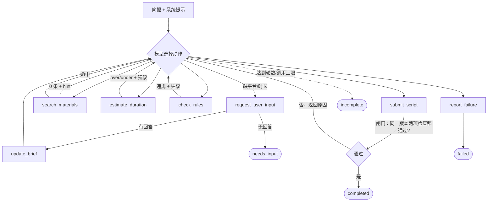

# 02 方案：调用流程、动态决策与技术取舍

## 1. 总体结构

```
main.py ── src/vsagent/cli.py          命令行：run（单用例）/ batch（批量）
              │
              ▼
        agent.py  ScriptAgent           ReAct 主循环 + 执行上限 + trace + 输出组装
          │  ▲
   tool_calls │ tool results (JSON)
          ▼  │
   llm/  openai_compat.py  ← DeepSeek（默认，OpenAI 兼容接口）
         mock.py           ← 离线规则策略（仅验证流程）
          │
   tools/registry.py  ToolSession       工具 schema、会话状态、提交闸门、故障注入
     ├─ materials.py   search_materials   素材检索（本地 JSON）
     ├─ duration.py    estimate_duration  时长估算（确定性公式）
     └─ rules.py       check_rules        规则检查（确定性规则）
   verify.py / scripts/verify_examples.py  独立核对输出（不信任 output.json 的结论）
```

**分工原则：模型负责“写”和“决定下一步”，工具负责“查”和“验”。** 时长和合规结论只来自确定性工具，模型不能自己宣布通过。

## 2. 调用流程（ReAct 循环）



每一轮：模型返回 tool_calls → `ToolSession.execute` 执行 → 结构化 JSON 结果作为 `tool` 消息追加 → 模型据此选下一步。代码层面**没有**“检索失败就自动改写”“超时就自动删句”之类的固定分支；这些都是模型看到工具结果后的选择，trace 里记录了每一步的依据。

## 3. 动态决策点（由模型决定）

| 决策点 | 工具给模型的观察 | 模型可选的动作 | 实际运行记录 |
|---|---|---|---|
| 简报缺字段 | 首条消息列出缺失关键字段；`estimate_duration` 在无目标时长时返回 `MISSING_TARGET` | 提问 / 对可选字段做假设并记入风险 | 03、03b |
| 检索 0 条 | `count=0`，`hint` 给出现有产品列表 | 改写查询词或产品名 / 请求用户补充素材 | 04、05 |
| 时长不达标 | `status=over/under`、`delta_sec`、逐镜秒数、“约需删减 N 字”的建议 | 删句、合并分镜、删卖点、补充有依据内容；再估算 | 02、08 |
| 规则不通过 | 违规列表（code / 位置 / 修改建议） | 按条修改后重新估算 + 重新检查 | 09 |
| 工具出错 | `{"ok": false, "error_type", "retryable"}` | 重试 / 换方案 / `report_failure` | 06、07 |
| 无法同时满足 | 多次修改后仍冲突 | `report_failure` 说明冲突与建议 | 08 |
| 提交被拒 | `VERIFICATION_REQUIRED` + 缺哪项检查 | 补做检查后再提交 | 单测覆盖 |
| 重复提交同一版本 | `DUPLICATE_SUBMISSION` + 上次结果 | 实际修改 / `report_failure` | 08 |

**两条执行路径的对比**（题目要求“模型根据不同工具结果调整动作”）：04 和 05 在第一步都检索到 0 条；05 中模型看到 hint 里的“帧跃 M2 无线麦克风”与用户写的“帧越 M2 领夹麦”相近，改写后命中并继续写稿；04 中“帧跃 X1 智能云台”与现有产品都不相近，改写后仍为 0 条，模型转为请求用户补充素材。同理 06 与 07：同样是工具报错，可恢复时重试后继续，持续失败时停止并说明。

## 4. 护栏（代码层面强制，与模型能力无关）

1. **提交闸门**：时长与规则结果按脚本内容指纹（SHA-1 前 10 位）记录为 v1、v2…；`submit_script` 要求关键简报完整、当前脚本的两项检查都通过。目标时长或风格变化使时长检查失效；平台或产品变化使规则检查失效。新检索到素材时，只作废引用该素材的脚本的规则检查。原来的检查记录仍可在 trace 中查看。
2. **引用必须检索过**：`check_rules` 只认本次会话 `search_materials` 返回过的素材 ID，防止模型凭记忆引用不存在或没看过的素材。
3. **目标不可篡改**：`update_brief` 只能在用户回复之后填补原本缺失的字段。时长必须匹配回答里的秒数或独立数字；其余文本字段用字符匹配近似判断。模型自己的假设（如影响语速的风格）写进 risks。
4. **执行上限**：最大决策轮数（默认 14）、工具调用总数（24）、单工具调用数（8）。用例只能收紧配置或命令行给定的上限。达到总调用或轮数上限返回 `incomplete`；单工具达到上限时，模型会收到结构化错误，可改走其他工具或结束。
5. **故障注入**：`--fault tool:transient[:n]` / `tool:permanent` 只改变工具返回值；代码不自动重试。
6. **决策依据**：每个工具都有必填参数 `decision_reason`（≤60 字），trace 记录的就是它；不记录模型内部思维（DeepSeek 思考模式的 `reasoning_content` 只按接口要求回传，不落盘）。

## 5. 工具设计细节

### 5.1 search_materials
- `product` 参数为**严格过滤**（与产品名/别名归一化后相等），写错就返回 0 条并给出 `known_products`；不传 `product` 时从 query 中识别产品名，再按关键词命中（+3）与字符二元组重叠（+0.5）打分。
- 只命中品牌名“帧跃”不算相关（否则任何查询都会命中品牌口号）。
- 取舍：没有用向量检索。素材库只有几条合成数据，关键词检索可解释、可复现，便于评审“改变检索结果，看下一步是否调整”。

### 5.2 estimate_duration（口径全部写在 `duration.py` 顶部注释）
- 汉字 1 音节、英文单词 1.5、数字按位数 ×1.3；语速默认 4.5 字/秒，按风格关键词切换（快节奏 5.0、讲解/干货 4.2、治愈 3.8）。
- 逗号类停顿 0.15s、句号类 0.3s、每镜转场 0.3s、单镜最短 1.5s。
- 每镜取“口播时间”与“字幕阅读时间（6 字/秒）”的较大值，也可用 `hold_sec` 指定停留；角标小字 `screen_note` 不计时。
  （第二轮真实运行中模型把卖点挪进长字幕、只保留极短口播来压时长，因此字幕也要计阅读时间。）
- 通过区间 [0.8×目标, 1.0×目标]。超时/不足时给出 `recommended_sec`（区间中部）和“约需删减/补充 N 字”，不足时提醒“不得为凑时长编造事实”。
  （第一轮真实运行发现：只告诉模型“超出上限 X 秒”时，它会每次删一两个字、贴着上限反复估算，见 03 第 4 节。）
- 超时时附逐镜删减建议 `cut_plan`：把需删减字数按旁白长度分摊到最长的 2–3 个镜头（如“镜头2删约5字、镜头3删约5字”）。
  （第三轮真实运行中，只告诉模型“约需删减 17 字”，它每次只删 2 字。）
- 同一版本重复提交给同一工具时不再重算，返回 `DUPLICATE_SUBMISSION` 错误（附上次结果），并说明“要么在 script 中实际修改，要么调用 report_failure”。
  （真实运行发现模型会声称“这次真正改了”却原样重复提交；只加提示时 08 仍重复了 6 次，改为错误后降到 1 次。）
- 首条消息附“写稿参考”：按当前风格语速，建议时长约多少秒、旁白大约多少字以内；用户补充目标时长后 `update_brief` 也返回这条参考。只是参考，结论仍以工具为准。
- 逐镜时长保留 1 位小数，总时长 = 逐镜之和，保证输出里“分镜时长加起来等于总时长”。

### 5.3 check_rules
| 规则 | 说明 |
|---|---|
| UNKNOWN_SOURCE | 引用不存在 / 未检索到的素材 |
| MISSING_SOURCE | 有宣称（含品牌名或“支持/能/一键”等宣称词）的功能/数字表述却没标来源；只是提到话题（如“还在手动打字幕？”）只给提示 |
| UNSUPPORTED_FEATURE | 功能词表中的词在所引素材里找不到（如只引 P01 却写“多语言翻译”） |
| UNSUPPORTED_NUMBER | 阿拉伯数字与“八成/两倍/三小时”等中文数量必须出现在所引素材里 |
| UNSUPPORTED_EFFECT_CLAIM | “提升/节省/缩短…”+数量，或“大幅/显著”+效果动词，且没有 effect_data 素材支撑 → 拦截“效率提升80%” |
| EFFECT_CLAIM_NEEDS_REVIEW（提示） | 定性效率表述（“帮你提升效率”），不阻断但进入风险 |
| BANNED_WORD / WRONG_BRAND_NAME | 广告极限词（“第一步”等不误伤）、品牌错写 |
| MISSING_BRAND_MENTION / MISSING_DISCLAIMER | 至少露出一次品牌名；引用带免责要求的素材（续航、传输距离、内部测试、价格）必须带说明 |
| TITLE_TOO_LONG / MISSING_TITLE | 按平台标题上限 |
| MISSING_REQUIRED_POINT | 用户 must_include 的要点必须出现在旁白或字幕中（只写在标题/发布文案或角标小字里不算） |

标题没有单独的来源字段，按“全片已引用素材”核对其中的数字和功能词。

## 6. 技术选型与取舍

| 决策 | 选择 | 理由 / 代价 |
|---|---|---|
| 框架 | 原生 Python 实现循环，未用 LangGraph / ADK / AgentScope | 循环本身约 100 行，闸门、上限、trace 都要精确控制，原生实现最直接，评审能一眼看清“谁在做决策”；代价是没有现成的可视化与持久化，不过本题不需要 |
| 模型 | DeepSeek `deepseek-flash`，OpenAI 兼容接口（`openai` SDK） | 用户指定 DeepSeek；同一客户端改 `LLM_BASE_URL`/`LLM_MODEL` 即可接其它 OpenAI 兼容服务 |
| 思考模式 | 默认 `thinking: disabled`，`temperature=0.3` | 工具调用场景下更快、更省、结果更稳定；可通过 `LLM_THINKING=enabled` 开启（客户端会按 DeepSeek 要求回传 `reasoning_content`） |
| base_url / key | 显式传给 SDK | 避免被系统里已有的 `OPENAI_BASE_URL` 等环境变量串到别的服务 |
| 时长/规则 | 确定性代码，不用模型自评 | 可复现、可单测、可独立核对；代价是语义理解有限（见 03 的限制） |
| 写稿方式 | 模型把完整脚本作为工具参数传入 | 每次检查都是完整版本，便于指纹绑定和版本对比；代价是 token 消耗随修改轮数增长 |
| 用户补充 | 非交互默认结束为 `needs_input`；`--answer` 预置回答 / `--interactive` 终端问答 | 评审运行可复现，同时演示“补充后继续”的完整闭环 |
| 离线入口 | `--llm mock` 规则策略 | 无 Key 也能跑通全部流程和测试；**只验证流程，不证明真实模型决策效果** |

## 7. Mock 的边界

`llm/mock.py` 是写死的启发式（例如“0 条结果时与 hint 中产品名字符重合 ≥40% 就改写”“超时依次删解释句、缩分句、删低优先级卖点”）。它的作用是：没有 Key 时验证循环、闸门、上限、trace、输出结构都正确，并让场景测试可离线复现。它的输出在 `examples/mock/`，每个结果都带“离线 Mock 策略运行”的说明。真实模型的决策效果只看 `examples/deepseek/`。
